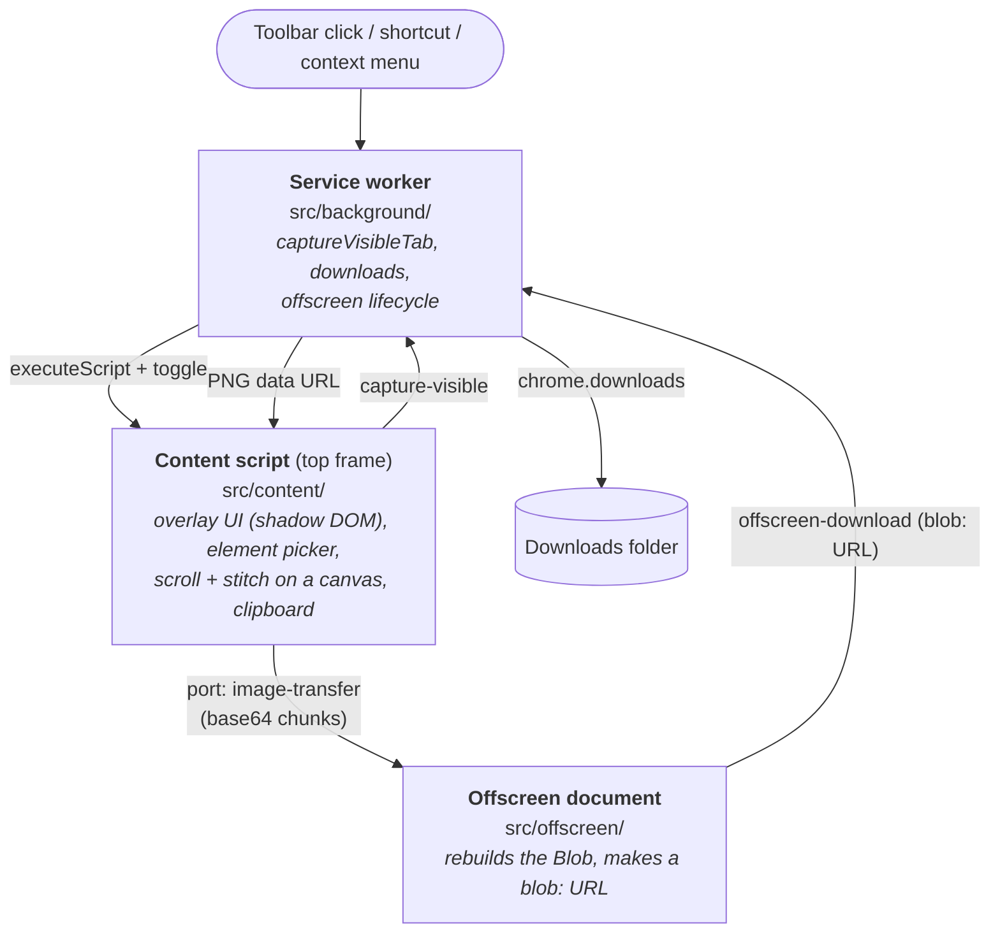

# Design notes

This document explains how Element Screenshotter works and why it is built
the way it is. Read it before making non-trivial changes.

## Goal

Recreate Firefox Screenshots (`browser/components/screenshots` in
mozilla-central) as a Chromium Manifest V3 extension:

- Hover to highlight a sensible element, click to select it.
- Drag to select an arbitrary region; resize or move it with handles or the
  keyboard.
- "Save visible" and "Save full page" with a preview dialog.
- Copy to clipboard or download as an image.

Element selection is the priority feature.

## Architecture

### Why each piece exists

- **Service worker.** It is the only context that can call
  `chrome.tabs.captureVisibleTab` and `chrome.downloads`. It holds no session
  state, because MV3 service workers can be killed at any time.
- **Content script.** It owns the whole screenshot session: the overlay, the
  element picker, scrolling, and compositing. It is injected on demand with
  `chrome.scripting.executeScript`, so the extension only needs `activeTab`
  and gets no "read all your data on all websites" warning.
- **Offscreen document.** Chrome rejects data URLs over about 2 MB in
  downloads, and service workers cannot call `URL.createObjectURL`. The
  offscreen document (reason `BLOBS`) turns the image bytes back into a Blob
  and returns a `blob:` URL that `chrome.downloads` can save.
  Extension messaging is JSON-only and capped at 64 MiB, so images are sent
  in base64 chunks over a port.

### Capturing pixels

Firefox uses the privileged `drawSnapshot`, which can render any part of the
page. Extensions have two options:

1. `chrome.tabs.captureVisibleTab`. This captures the viewport only, with no
   infobar and no extra permission, but Chrome limits it to 2 calls per
   second.
2. `chrome.debugger` + `Page.captureScreenshot`. This can render beyond the
   viewport, but shows a "started debugging this browser" infobar. It also
   resizes the viewport, which breaks `vh`-based layouts, and it needs a scary
   permission.

We use option 1. Anything bigger than the viewport is captured by scrolling
and stitching tiles (`src/content/capture.ts`):

- Scrolling is instant, and `scroll-snap-type` / `scroll-behavior` are
  overridden for the duration.
- Tile placement uses the scroll position the browser actually reached, not
  the one we asked for. Right-to-left pages (negative `scrollX`) work.
- If the region already starts on screen, the first tile is taken at the
  user's current scroll position. What they saw is captured as they saw it.
- `position: fixed` and `sticky` elements would repeat on every tile. The
  rules:
  - **Full page:** they stay in the first tile (the top of the page) and are
    hidden after it.
  - **Element or region:** if the first tile is exactly what the user sees,
    it is captured as is, and everything fixed is hidden after that.
    Otherwise, fixed elements outside the selection are hidden from the
    start, so a header can't cover the top of a scrolled-to element. Sticky
    parts inside the selected element (a table header, say) stay for the
    first tile.
  - Ancestors of the selected element are never hidden, since that would
    hide the element.
- The capture scale is `devicePixelRatio` when it agrees with the bitmap.
  Otherwise it is the measured `bitmap.width / innerWidth`. The measured
  ratio is slightly wrong at fractional scales like 1.25, because
  `innerWidth` is rounded to whole pixels. Either way it accounts for zoom.
- Output is clamped to 32,766 px per side and about 124.9 M px in total,
  matching Firefox, and the user is told when the image is cropped.

The overlay is made transparent (`opacity: 0`) rather than removed while
capturing. It still swallows pointer events, so page `:hover` styles do not
flash into the screenshot.

### Overlay UI

- A custom element is placed in the **top layer** using `popover="manual"`.
  This puts it above any page `z-index` or stacking context.
- It uses a **closed shadow root** with **constructable stylesheets**
  (`adoptedStyleSheets`), which page CSP `style-src` does not block. Inline
  positions are set through CSSOM (`el.style.foo = ...`), which CSP also
  allows.
- Images (the preview) are drawn on `<canvas>`, never ``, so a
  page `img-src` CSP cannot block them.
- Pointer and mouse events are stopped inside the shadow root, so page
  handlers never see clicks on the overlay. Keys are handled by a
  capture-phase listener on `window`, the earliest point an extension can
  reach, so pages can't swallow Escape or fire their own shortcuts.
- The host sets `dir="ltr"` explicitly. `all: initial` does not reset
  `direction`, so without it a right-to-left page flips the (English) UI.

### Element picker

`src/content/element-picker.ts` ports Firefox's `getBestRectForElement`
heuristic. It starts from the element under the cursor:

- an element smaller than 100x30 is kept as is, unless it is under 30x10, in
  which case nothing is highlighted
- headings are skipped in favour of their parent
- if the element is bigger than the viewport plus 100 px (at least
  1000x700), the previous, smaller element wins
- an enclosing `role="article"` that fits is preferred

Firefox can also merge the chosen element with its next sibling. We drop
that, so the highlight is always a real element, which the tree navigation
below needs.

On top of that, we add:

- **Element-tree navigation.** Arrow keys go to the parent, child, and
  siblings, so any element is reachable. Firefox uses the arrows to move the
  cursor, which extensions can't do.
- An **"exact" mode** (setting) that starts at the element under the cursor
  instead of the heuristic's choice.
- **Shadow DOM piercing**, including closed roots via
  `chrome.dom.openOrClosedShadowRoot`.
- **Same-origin iframes** are entered. Cross-origin iframes are selected as a
  whole.
- A **label** showing the element's tag, id, and classes plus its size.

## Decisions and open questions

Most of these were decided up front, and each one can be changed.

| Topic            | Decision                                                                      | Why / risk                                                                                                                                                                   |
| ---------------- | ----------------------------------------------------------------------------- | ---------------------------------------------------------------------------------------------------------------------------------------------------------------------------- |
| License          | MPL-2.0                                                                       | The element heuristic, region math, and face SVG are ported from Firefox (MPL-2.0). MPL is file-level copyleft, so the rest could be relicensed, but one license is simpler. |
| Capture backend  | `captureVisibleTab` + stitching                                               | No infobar or scary permission. Costs: about 0.5 s per tile, and `fixed`/`sticky` handling is heuristic.                                                                     |
| Permissions      | `activeTab`, `scripting`, `downloads`, `offscreen`, `storage`, `contextMenus` | Only `downloads` shows an install warning ("Manage your downloads"). No host permissions.                                                                                    |
| Default shortcut | `Ctrl+Shift+S` (`Cmd+Shift+S` on macOS)                                       | Same as Firefox. Chrome silently skips it if another extension already uses it.                                                                                              |
| Clipboard        | `navigator.clipboard.write` in the content script                             | Fails on plain `http://` pages (not a secure context). Download still works there, and the user gets a clear message.                                                        |
| Scope            | Top frame only                                                                | Same-origin iframes are pierced. Cross-origin iframes can only be captured as a whole rectangle.                                                                             |
| Inner scrollers  | Not stitched                                                                  | "Full page" scrolls the window only. Apps that scroll an inner `
` capture just the viewport, as in Firefox.                                                             |
| Restricted pages | Not supported                                                                 | `chrome://`, the Web Store, other extensions' pages and the PDF viewer can't be scripted. The toolbar badge shows an error.                                                  |
| Browser support  | Chromium 116+                                                                 | Needs `runtime.getContexts`, popover, and `offscreen`. Tested on Helium (Chromium 156).                                                                                      |
| Distribution     | GitHub releases (zip), loaded unpacked                                        | No web store listing. The repository is private for now.                                                                                                                     |
| TypeScript       | `tsc` is TS 7; the `typescript` package is the TS 6 API                       | typescript-eslint can't load TS 7.0, which has no JS API. Remove the alias once typescript-eslint supports TS 7.1. See development.md.                                       |
| CI/CD            | GitHub Actions + Dependabot; tag-triggered releases                           | Checks and e2e run on Linux, Windows, and macOS (private pull requests: Linux only). CodeQL and release provenance switch on when public. Tests download Chrome for Testing. |
